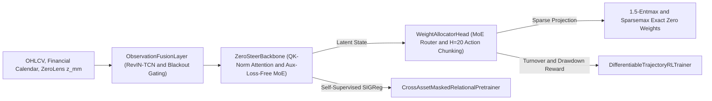

<div align="center">

[](./README.md)
[](./README.en.md)

[🇰🇷 한국어](./README.md) · [🇺🇸 English](./README.en.md)

</div>

# zerosteer (`v0.2.0`) — Local Edge Policy Engine (Layer 1)

> **No noisy dust weights across 100 tickers.**  
> `zerosteer` (Public MIT) pairs a cross-asset MoE backbone with a customer-specific action-chunking (`H=20`) allocation head that zeroes out unconvincing assets via `1.5-Entmax` and executes privately on local hardware.

---

## Why `zerosteer`?

Conventional quantitative models suffer from three practical flaws:

1. **Softmax Weight Dilution**: Standard `softmax` gives non-zero weight to every ticker, inflating turnover and brokerage fees. `zerosteer` uses **`1.5-Entmax` / `Sparsemax`** to assign an exact `0.0` weight to weak candidates.
2. **Myopic 1-Step Prediction**: Optimizing only next-bar returns ignores multi-day turnover costs and drawdown paths. `zerosteer` generates a **20-step action chunk (`H=20`)** and trains with differentiable **`TrajectoryRLLoss`**.
3. **Coupled Backbone & User Constraints**: Mixing shared market modeling with proprietary client preferences forces investors to leak strategy logic to third-party servers. `zerosteer` separates `ZeroSteerBackbone` from the lightweight `WeightAllocatorHead`.

---

## v0.2.0 Architecture Overview



### Core Modules

| Module | Key Symbols | Role |
| :--- | :--- | :--- |
| [`model.py`](./src/zerosteer/model.py) | `ZeroSteerBackbone`, `WeightAllocatorHead`, `ZeroSteer` | Splits shared cross-asset backbone from horizon-aware customer policy head |
| [`moe.py`](./src/zerosteer/moe.py) | `QKNormMultiheadAttention`, `SwiGLUFeedForward`, `AuxLossFreeMoEGate`, `MoETransformerBlock` | DeepSeek-style Aux-Loss-Free Top-K MoE blocks with RMSNorm and QK-Norm |
| [`adapters.py`](./src/zerosteer/adapters.py) | `TimeseriesEncoder`, `FinancialCalendarEncoder`, `DynamicEmbeddingAdapter`, `ObservationFusionLayer` | RevIN temporal encoding, cyclical calendar cues, and blackout-aware feature fusion |
| [`activations.py`](./src/zerosteer/activations.py) | `entmax15`, `sparsemax`, `Entmax15`, `Sparsemax` | Differentiable simplex activations for concentrated, zero-padded allocations |
| [`pretrain.py`](./src/zerosteer/pretrain.py) | `compute_sigreg_loss`, `CrossAssetMaskedRelationalPretrainer` | Label-free cross-asset masked relational pretraining with SIGReg isotropy loss |
| [`rl_trainer.py`](./src/zerosteer/rl_trainer.py) | `TrajectoryRLLoss`, `DifferentiableTrajectoryRLTrainer` | Differentiable trajectory policy optimization over Sharpe, turnover, and drawdown |
| [`diagnostics.py`](./src/zerosteer/diagnostics.py) & [`benchmark.py`](./src/zerosteer/benchmark.py) | `evaluate_backbone_representations`, `run_oos_comparison` | Effective-rank diagnostics and out-of-sample backtest comparison |

---

## Verification & Configuration

```bash
uv sync --extra dev
uv run ruff check .
uv run pytest -q
```

- Sample policy config: [`config.example.yaml`](./config.example.yaml)
- Repository Wiki (Korean-primary): [./openwiki/quickstart.md](./openwiki/quickstart.md)
