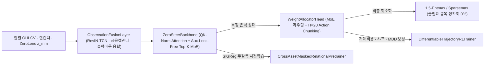

<div align="center">

[](./README.md)
[](./README.en.md)

[🇰🇷 한국어](./README.md) · [🇺🇸 English](./README.en.md)

</div>

# zerosteer (`v0.2.0`) — 내 컴퓨터에서 돌아가는 투자 정책 두뇌 (Layer 1 Policy Engine)

> **수백 개 종목을 애매하게 조금씩 담지 않습니다.**  
> `zerosteer`는 시장의 시세와 요약 정보(`z_mm`)를 읽어 내 투자 성향에 맞게 **핵심 종목만 또렷하게 고르고(1.5-Entmax), 향후 20거래일 행동 궤적을 함께 계획하는** 오픈소스(MIT) 포트폴리오 정책 엔진입니다.

---

## 왜 `zerosteer`가 필요한가요?

기존 AI 투자 모델이나 퀀트 도구를 실제로 쓰다 보면 세 가지 큰 한계에 부딪힙니다.

1. **전 종목에 소수점 비중을 흩뿌리는 '물타기 현상'**  
   일반 `Softmax` 출력층은 확신이 없는 종목에도 무조건 0보다 큰 비중을 배정합니다. 결국 불필요한 종목까지 너무 많이 담겨 수수료만 늘고 핵심 수익 기회가 흐려집니다. `zerosteer`는 **`1.5-Entmax` / `Sparsemax`**를 써서 기준에 못 미치는 자산의 비중을 깔끔하게 **정확한 `0.0`**으로 비워 줍니다.
2. **내일 당장의 가격 등락만 맞추다 보면 잦은 매매로 수수료가 수익을 갉아먹습니다.**  
   `zerosteer`는 단발성 예측 대신 한 번에 **20거래일(`H=20`) 비중 경로**를 함께 계획하고, 거래비용·변동성·최대낙폭(MDD)을 직접 반영하는 미분 가능한 **궤적 강화학습(`TrajectoryRLLoss`)**으로 학습됩니다.
3. **클라우드가 학습한 공통 시장 지식과 내 개인 투자 기준이 한 코드에서 분리되지 않으면 계좌 전략이 유출됩니다.**  
   `zerosteer`는 종목 간 관계를 읽는 **공통 백본(`ZeroSteerBackbone`)**과 내 Risk 성향을 반영하는 **가벼운 개인 정책 헤드(`WeightAllocatorHead`)**를 분리해, 내 계좌 맞춤형 추론을 로컬 PC 안에서 안전하게 끝냅니다.

---

## v0.2.0 핵심 구조 한눈에 보기



### 주요 모듈 구성

| 모듈 | 핵심 구성 요소 | 소비자 관점 역할 |
| :--- | :--- | :--- |
| [`model.py`](./src/zerosteer/model.py) | `ZeroSteerBackbone`, `WeightAllocatorHead`, `ZeroSteer`, `build_horizon_attention_mask` | 시장 관계 파악(Backbone)과 개인 비중 산출(Head)을 깔끔히 분리해 로컬 실행 지원 |
| [`moe.py`](./src/zerosteer/moe.py) | `QKNormMultiheadAttention`, `SwiGLUFeedForward`, `AuxLossFreeMoEGate`, `MoETransformerBlock` | 시장 국면(상승·변동성·금리충격 등)마다 알맞은 전문가 레이어를 동적 선택 |
| [`adapters.py`](./src/zerosteer/adapters.py) | `TimeseriesEncoder`, `FinancialCalendarEncoder`, `DynamicEmbeddingAdapter`, `ObservationFusionLayer` | 시세 변동성 정규화(RevIN)와 옵션만기·결산일 같은 금융 캘린더 신호를 결합 |
| [`activations.py`](./src/zerosteer/activations.py) | `entmax15`, `sparsemax`, `Entmax15`, `Sparsemax` | 소수 핵심 종목에만 집중하고 나머지는 `0.0`으로 비우는 희소 비중 활성화 함수 |
| [`pretrain.py`](./src/zerosteer/pretrain.py) | `compute_sigreg_loss`, `CrossAssetMaskedRelationalPretrainer` | 미래 수익률 정답지 없이 종목 간 동조·선행 관계와 표현 다양성 사전학습 |
| [`rl_trainer.py`](./src/zerosteer/rl_trainer.py) | `TrajectoryRLLoss`, `DifferentiableTrajectoryRLTrainer` | 실제 거래비용과 낙폭 한도를 반영한 20일 궤적 강화학습 파인튜닝 |
| [`diagnostics.py`](./src/zerosteer/diagnostics.py) · [`benchmark.py`](./src/zerosteer/benchmark.py) | `evaluate_backbone_representations`, `run_oos_comparison` | 표현 붕괴(Effective Rank) 및 아웃오브샘플(OOS) 실전 성과 진단 |

---

## 설치, 설정 및 검증

```bash
# 의존성 설치, 린트 및 전체 테스트(MPS 패리티 포함) 실행
uv sync --extra dev
uv run ruff check .
uv run pytest -q
```

- 설정 예시 파일: [`config.example.yaml`](./config.example.yaml)
- 상세 가이드 및 도해: [OpenWiki 빠른 시작 (한국어)](./openwiki/quickstart.md) · [직관적 시각화 가이드](./openwiki/guides/intuitive-visual-guide.md) · [백본·어댑터 구조](./openwiki/architecture/backbone-and-adapters.md) · [사전학습·궤적 RL](./openwiki/workflows/pretrain-and-trajectory-rl.md)
