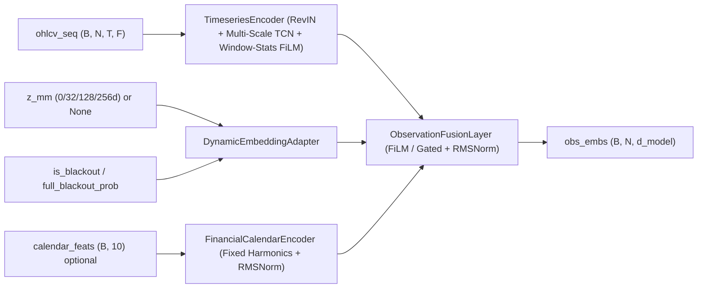

# ZeroSteer v2 Backbone, Adapters & Policy Split / ZeroSteer v2 관계형 백본, 어댑터 및 Policy Head 분리

`zerosteer` implements ZeroStreet's MIT open-source portfolio control architecture (**ZeroSteer v2**), enforcing a strict architectural and cryptographic separation between the shareable **Cross-Asset Relational Backbone (`ZeroSteerBackbone`)** and per-customer **Policy Heads (`WeightAllocatorHead`)**, while supporting full `ZeroSteerConfig.legacy_v1()` ablation toggling.

`zerosteer`는 ZeroStreet의 오픈소스(MIT) 포트폴리오 제어 아키텍처(**ZeroSteer v2**)로서, 공유 가능한 **Cross-Asset 관계형 백본(`ZeroSteerBackbone`)**과 고객별 컴파일 전용 **Policy Head(`WeightAllocatorHead`)**를 아키텍처 및 무결성 매니페스트 차원에서 엄격히 분리하며 `ZeroSteerConfig.legacy_v1()` 어블레이션 프리셋을 함께 지원합니다.

---

## 1. Single-Pass Observation Fusion (`adapters.py`) / 단일 패스 관측 융합

[`ObservationFusionLayer`](../../src/zerosteer/adapters.py) runs once per batch to fuse normalized multi-scale OHLCV features, dynamic multimodal embeddings (`z_mm`), and optional 10-dimensional harmonic financial calendar features (`calendar_feats`).

[`ObservationFusionLayer`](../../src/zerosteer/adapters.py)는 배치당 1회 실행되어 RevIN 다중 스케일 시계열 특성, 가변 차원 멀티모달 임베딩(`z_mm`), 선택적 10차원 금융 캘린더 피처(`calendar_feats`)를 단일 패스로 융합합니다.

* **Zero-Std-Safe RevIN + Multi-Scale ModernTCN + Window-Stats FiLM (`TimeseriesEncoder`) / Zero-Std 안전 RevIN·다중 스케일 TCN·윈도우 통계 FiLM**: Normalizes `(B*N, T, F)` inputs using `unbiased=False` variance and `sqrt(var + 1e-5)` so zero-variance assets such as `CASH` remain exact finite zeros (`0.0`), feeds multi-scale depthwise convolutions (`temporal_kernel_sizes=(3, 7, 15)`), anchors reversed recency position embeddings so index `0` is always the latest bar (`t-1`), and re-injects `[mean, log1p(std)]` scale information via `window_film`. (`unbiased=False`와 `sqrt(var + 1e-5)`로 `CASH` 자산의 NaN을 방지하고, 다중 스케일 TCN과 역순 최근성 포지셔널 임베딩 및 `window_film`으로 스케일 손실을 복구합니다.)
* **10-Dim Multi-Periodic Calendar Conditioning (`extract_calendar_features`, `FinancialCalendarEncoder`) / 10차원 다주기 금융 캘린더 조건화**: Computes weekday, quarterly (`k=1,2`), and yearly (`k=1,2`) sin/cos harmonics in `extract_calendar_features()` and projects them through a non-trainable sinusoidal matrix plus `RMSNorm` and learnable `gate` (`init_gate=0.05`) inside `FinancialCalendarEncoder`. (`extract_calendar_features()`가 요일·분기·연간 주기 고조파 10차원을 추출하며, `FinancialCalendarEncoder`가 고정 투영 행렬과 학습형 `gate`로 융합 표현에 반영합니다.)
* **Dynamic `z_mm` & Blackout Adapter (`DynamicEmbeddingAdapter`) / 가변 차원 동적 어댑터**: Projects `supported_dims=(32, 128, 256)` via `Linear + RMSNorm + SiLU` and substitutes learnable `mask_signal_token` when `z_mm is None`, `dim == 0`, `is_blackout=True`, or stochastic blackout triggers. (`z_mm` 결측·블랙아웃 상황에서도 학습된 `mask_signal_token`으로 끊김 없는 OHLCV 단독 추론을 보장합니다.)

---

## 2. QK-Norm SDPA, Aux-Loss-Free MoE & Action Chunking (`moe.py`, `model.py`) / QK-Norm 어텐션, Aux-Loss-Free MoE 및 행동 청킹

[`ZeroSteerBackbone.forward_backbone`](../../src/zerosteer/model.py) generates `H` portfolio horizon blocks `[P_0, ..., P_{H-1}]` from `obs_embs` and processes the concatenated sequence `[obs_embs, P_0, ..., P_{H-1}]` through [`MoETransformerBackbone`](../../src/zerosteer/moe.py).

[`ZeroSteerBackbone.forward_backbone`](../../src/zerosteer/model.py)는 `obs_embs`에서 `H`일 호라이즌 블록을 전개해 [`MoETransformerBackbone`](../../src/zerosteer/moe.py)에 통과시킵니다.

1. **Per-Head QK-Norm & Inverted Boolean SDPA Mask (`QKNormMultiheadAttention`) / 헤드별 QK-Norm 및 SDPA 마스크 반전**: Normalizes `q` and `k` per head via `RMSNorm(head_dim)` before `F.scaled_dot_product_attention`, explicitly inverting boolean masks (`sdpa_mask = ~attn_mask`) from `build_horizon_attention_mask` (`True=blocked`) into PyTorch SDPA semantics (`True=attend`) so `obs_embs` never leak future horizon tokens. (헤드별 Q/K `RMSNorm`과 bool 마스크 반전(`~attn_mask`)을 적용해 SDPA에서도 미래 토큰 오염을 원천 차단합니다.)
2. **SwiGLU FFN & DeepSeek-V3 Aux-Loss-Free MoE (`TopKMoELayer`, `AuxLossFreeMoEGate`) / SwiGLU FFN 및 Aux-Loss-Free MoE**: Replaces legacy dense GeGLU with bias-free `SwiGLUFeedForward` (`ffn_activation="swiglu"`), selects top-k routed experts with adaptive `bias` vectors (`score_func="sigmoid"` or `"softmax"`) adjusted outside autograd via `update_gate_bias()`, and uses out-of-place `routed_out = routed_out.index_add(...)` for Apple Silicon MPS compatibility. (SwiGLU FFN과 자동 미분 외부에서 균형을 맞추는 `AuxLossFreeMoEGate`, 그리고 Apple Silicon MPS 호환 out-of-place `index_add`를 채택했습니다.)
3. **`P_0` Zero Initialization & Previous Weight Anchoring (`ZeroSteerBackbone`) / `P_0` 영벡터 초기화 및 직전 비중 앵커링**: Zero-initializes `horizon_encodings.weight[0]`, adds `weight_encoder(prev_weights)` exclusively into `P_0`, and prevents observation leakage via `build_horizon_attention_mask`. (당일 `P_0` 블록만 `prev_weights`를 직접 주입하여 다기간 누적 드리프트 오차를 차단합니다.)

---

## 3. 0-Byte Policy Split, MoE Allocator Head & SHA-256 Manifests (`model.py`, `config.py`) / 0바이트 정책 분리, MoE 헤드 및 SHA-256 매니페스트

| Component / 구성 요소 | Contract & Invariant / 계약 및 불변식 | Source / 출처 |
| :--- | :--- | :--- |
| **`ZeroSteer.__init__`** | Raises `ValueError` immediately if `user_config is None` (0 bytes of company policy weights). / `user_config=None` 시 즉시 `ValueError`를 발생시킵니다. | [`model.py`](../../src/zerosteer/model.py) |
| **`WeightAllocatorHead`** | Supports v2 MoE head (`use_moe_allocator=True`: `RMSNorm + TopKMoELayer(out_dim=1)`) and v1 MLP fallback, masking invalid assets (`-1e9`) before `entmax15`, `sparsemax`, or `softmax`. / v2 MoE 헤드 및 v1 MLP를 모두 지원하며 거래 불가 자산을 `-1e9` 마스킹 후 희소 심플렉스를 출력합니다. | [`model.py`](../../src/zerosteer/model.py) |
| **`save_backbone` / `load_backbone`** | Writes `<stem>.manifest.json` (`sha256`, `backbone_version="zerosteer-backbone-v2"`, `has_policy_head=False`) and rejects tampered checkpoints with `ValueError` when `verify_sha256=True`. / SHA-256 동위 매니페스트를 기록하고 로드 시 변조된 파일을 `ValueError`로 거부합니다. | [`model.py`](../../src/zerosteer/model.py) |
| **`save_policy_head` / `load_policy_head`** | Persists compiled user `policy_head_state_dict` separately with `<stem>.manifest.json` SHA-256 verification. / 사용자 컴파일 정책 헤드만 별도 저장하며 SHA-256 무결성을 검증합니다. | [`model.py`](../../src/zerosteer/model.py) |
| **`ZeroSteerConfig.legacy_v1()`** | Toggles off RevIN+TCN, calendar encoder, QK-Norm, SwiGLU, Aux-Loss-Free MoE, MoE allocator, and SIGReg for controlled v1-vs-v2 ablations. / v1 대조 어블레이션 테스트용 설정 프리셋을 제공합니다. | [`config.py`](../../src/zerosteer/config.py) |

## Verification & Related Pages / 검증 및 관련 문서

* Architecture unit & parity coverage lives in [`tests/test_zerosteer_v2_architecture.py`](../../tests/test_zerosteer_v2_architecture.py) (`15 passed`, covering SDPA leakage, `CASH` zero-std RevIN, FiLM scale, calendar fusion, MoE load balance, frozen buffers, tamper detection, `legacy_v1()`, and Apple Silicon MPS parity). (아키텍처 검증 테스트는 `tests/test_zerosteer_v2_architecture.py`에 구현되어 있습니다.)
* [zerosteer Overview & Quickstart / 개요 및 빠른 시작](../quickstart.md)
* [Pretraining, SIGReg, Diagnostics & Trajectory RL / 사전학습, SIGReg, 표현 진단 및 궤적 RL](../workflows/pretrain-and-trajectory-rl.md)
