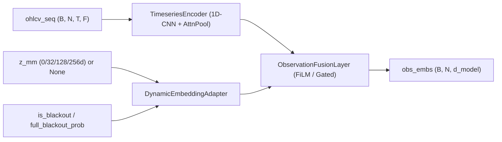

# Model B Relational Backbone, Adapters & Action Chunking / Model B 관계형 백본, 어댑터 및 다기간 Action Chunking

`hyperalpha-vla` is ZeroStreet's MIT open-source portfolio allocation architecture (`Model B`), enforcing a hard separation between the shareable **Cross-Asset Relational Backbone (`HyperAlphaVLABackbone`)** and user-compiled per-customer **Policy Heads (`WeightAllocatorHead`)**.

`hyperalpha-vla`는 ZeroStreet의 오픈소스(MIT) 포트폴리오 의사결정 모델(`Model B`)로, **공유 가능한 Cross-Asset 관계형 백본(`HyperAlphaVLABackbone`)**과 **유저 에이전트 개별 컴파일 전용 Policy Head(`WeightAllocatorHead`)**를 엄격히 분리합니다.

---

## 1. Single-Pass Observation Fusion (`adapters.py`) / 단일 패스 관측 융합

[`ObservationFusionLayer`](../../src/hyperalpha_vla/adapters.py) runs once per batch to combine encoded OHLCV sequences with variable-dimension multimodal embeddings (`z_mm`).

`ObservationFusionLayer`는 배치당 단 1회 실행되어 시계열 표현과 동적 멀티모달 임베딩(`z_mm`)을 융합합니다.

* **Ticker-Agnostic `TimeseriesEncoder` / 종목 비종속 시계열 인코더**: Eliminates static ticker-index lookups via shared 1D-CNN + `LayerNorm` + attention pooling over arbitrary universes. (고정 종목 매핑을 제거하고 1D-CNN과 어텐션 풀링으로 임의의 종목 유니버스를 수용합니다.)
* **`DynamicEmbeddingAdapter` / 가변 차원 동적 어댑터**: Maintains projections for `supported_dims=(32, 128, 256)` and injects a learnable `mask_signal_token` when `z_mm is None`, `dim == 0`, or `is_blackout=True`, keeping local OHLCV-only fallback operational. (`z_mm` 결측 또는 블랙아웃 시 학습된 `mask_signal_token`을 주입해 OHLCV 단독 추론이 끊기지 않도록 합니다.)

---

## 2. Multi-Horizon Action Chunking & Asymmetric Masking (`model.py`, `moe.py`) / 다기간 행동 청킹 및 비대칭 마스킹

`HyperAlphaVLABackbone.forward_backbone` ([`model.py`](../../src/hyperalpha_vla/model.py)) spawns `H` horizon blocks `[P_0, ..., P_{H-1}]` from `obs_embs` and forwards them through `MoETransformerBackbone` ([`moe.py`](../../src/hyperalpha_vla/moe.py)), stacking `n_dense_layers` dense blocks followed by Shared + Top-K Routed MoE blocks.

`HyperAlphaVLABackbone.forward_backbone`은 `obs_embs`로부터 향후 `H`일 블록을 생성하고 Dense+MoE 하이브리드 `MoETransformerBackbone`을 통과시킵니다.

1. **`P_0` Zero Horizon Initialization / 당일 블록 영벡터 초기화**: Initializes `horizon_encodings.weight[0]` to zeros for stable day-0 execution embeddings. (`horizon_encodings.weight[0]`을 0으로 초기화해 당일 실행 블록을 안정화합니다.)
2. **`P_0`-Only Previous Weight Anchoring / 당일 블록 전용 직전 비중 앵커링**: Projects current holdings `prev_weights` through `weight_encoder` and adds them strictly to `k=0` (`P_0`); future blocks receive initial portfolio context through self-attention without cumulative drift error. (실제 보유 비중 `prev_weights`는 오직 `P_0` 블록에만 더해져 오차 누적을 방지합니다.)
3. **Asymmetric 2D Mask (`build_horizon_attention_mask`) / 비대칭 2D 호라이즌 마스크**: Masks (`True`) future blocks `P_1..P_{H-1}` from observation tokens `obs_embs` and supports `bidirectional_portfolio`, `causal_portfolio`, and `backward_dp` horizon modes. (`obs_embs`의 미래 참조를 차단하며 3가지 호라이즌 마스킹 모드를 지원합니다.)

---

## 3. 0-Byte Policy Head Split & Sparse Simplex Projections (`activations.py`) / Policy Head 분리 및 희소 심플렉스

| Module / Method / 모듈·메서드 | Regulatory & Numerical Invariant / 규제·수치 불변식 |
| :--- | :--- |
| **`HyperAlphaVLA.__init__`** | Keeps `user_config=None` default and immediately raises `ValueError` if missing, guaranteeing **0 bytes** of vendor policy weights. / `user_config` 미입력 시 즉시 `ValueError`를 발생시킵니다. |
| **`HyperAlphaVLABackbone.save_backbone`** | Saves only config + relational backbone weights with zero `policy_head` keys. / 순수 관계형 백본 파라미터만 저장합니다. |
| **`WeightAllocatorHead`** | Masks invalid assets with `-1e9` in FP32 logits and applies `entmax15`, `sparsemax`, or `softmax` (`Entmax15Function`, `SparsemaxFunction` in [`activations.py`](../../src/hyperalpha_vla/activations.py)). / 거래 불가 자산 마스킹 후 희소 심플렉스 비중을 산출합니다. |

## Related Documentation / 관련 문서

* [hyperalpha-vla Quickstart & Business Overview / 빠른 시작 및 비즈니스 개요](../quickstart.md)
* [Relational Pretraining, Trajectory RL & OOS Benchmark / 관계형 사전학습 및 궤적 RL](../workflows/pretrain-and-trajectory-rl.md)
