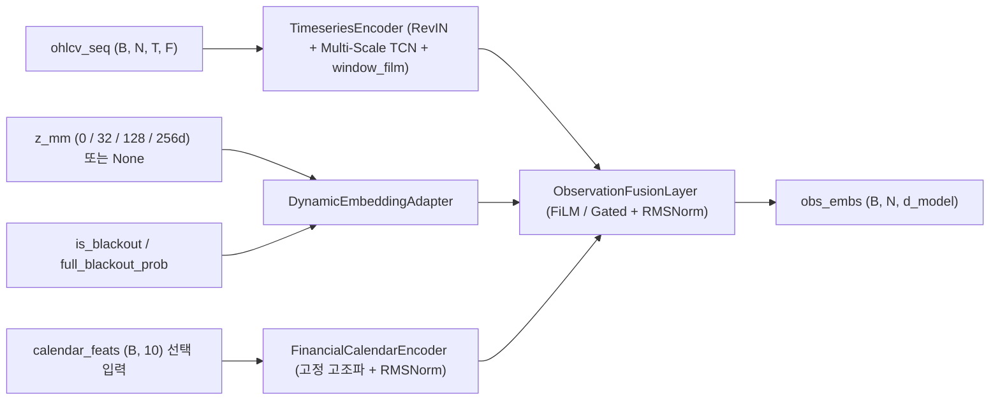

# ZeroSteer v2 백본 · 어댑터 및 정책 분리 아키텍처

`zerosteer`는 제로스트리트의 오픈소스(MIT) 포트폴리오 제어 아키텍처(**ZeroSteer v2**)입니다. 누구나 공유할 수 있는 **Cross-Asset 관계형 백본(`ZeroSteerBackbone`)**과 고객별 컴파일 전용 **정책 헤드(`WeightAllocatorHead`)**를 아키텍처와 SHA-256 무결성 검증 차원에서 완전히 분리하며, v1 기준선과 공정하게 비교할 수 있는 `ZeroSteerConfig.legacy_v1()` 프리셋도 함께 제공합니다.

---

## 1. 단일 패스 관측 융합 (`adapters.py`)

[`ObservationFusionLayer`](../../src/zerosteer/adapters.py)는 배치마다 한 번씩 실행되어 정제된 시계열 특성, 가변 차원 멀티모달 임베딩(`z_mm`), 선택적 10차원 금융 캘린더 피처(`calendar_feats`)를 하나로 결합합니다 ([adapters.py](../../src/zerosteer/adapters.py#L37-L385)).

- **무변동 현금 자산까지 안전한 RevIN · 다중 스케일 ModernTCN · 윈도우 통계 FiLM (`TimeseriesEncoder`)**: `(B*N, T, F)` 시계열을 `unbiased=False` 분산과 `sqrt(var + 1e-5)`로 정규화해 가격 변동이 `0`인 `CASH=1.0` 자산에서도 `NaN`이 발생하지 않고 정확히 `0.0`을 유지합니다. `(3, 7, 15)` 다중 스케일 깊이별(depthwise) 합성곱을 적용하며, 역순 최근성 포지셔널 임베딩으로 인덱스 `0`이 항상 가장 최신 봉(`t-1`)을 가리키게 한 뒤 `window_film`으로 `[mean, log1p(std)]` 스케일 정보를 되살려 현금과 고변동 주식의 차이를 보존합니다.
- **10차원 금융 캘린더 조건화 (`extract_calendar_features`, `FinancialCalendarEncoder`)**: 요일·분기(`k=1,2`)·연간(`k=1,2`) `sin`/`cos` 주기 고조파 10차원을 계산해 학습되지 않는 고정 사인파 투영 행렬과 `RMSNorm`, 학습형 `gate`(`init_gate=0.05`)로 반영합니다 (`calendar_feats=None`이면 자동으로 건너뜁니다).
- **가변 `z_mm` 및 블랙아웃 어댑터 (`DynamicEmbeddingAdapter`)**: `supported_dims=(32, 128, 256)`을 `Linear + RMSNorm + SiLU`로 투영하며, `z_mm is None`, `dim == 0`, `is_blackout=True` 상황에서는 학습된 `mask_signal_token`을 대신 넣어 로컬 OHLCV 단독 추론이 매끄럽게 이어지도록 합니다.

---

## 2. QK-Norm SDPA, Aux-Loss-Free MoE 및 행동 청킹 (`moe.py`, `model.py`)

[`ZeroSteerBackbone.forward_backbone`](../../src/zerosteer/model.py)은 `obs_embs`로부터 향후 `H`일 호라이즌 블록 `[P_0, ..., P_{H-1}]`을 펼치고 전체 시퀀스 `[obs_embs, P_0, ..., P_{H-1}]`을 [`MoETransformerBackbone`](../../src/zerosteer/moe.py)에 통과시킵니다 ([model.py](../../src/zerosteer/model.py#L76-L305), [moe.py](../../src/zerosteer/moe.py#L107-L359)).

1. **헤드별 QK-Norm과 불리언 SDPA 마스크 반전 (`QKNormMultiheadAttention`)**: `F.scaled_dot_product_attention` 직전에 쿼리(`q`)와 키(`k`)를 헤드별 `RMSNorm(head_dim)`으로 정규화해 어텐션 점수 폭주를 막습니다. 또한 `build_horizon_attention_mask`는 `True=차단` 규칙인 반면 PyTorch SDPA는 `True=허용` 규칙을 쓰므로 **`sdpa_mask = ~attn_mask`**로 반전해 오늘의 관측(`obs_embs`)이 미래 계획 블록(`P_1..P_{H-1}`)을 엿보지 못하게 원천 차단합니다.
2. **SwiGLU FFN과 DeepSeek-V3 스타일 Aux-Loss-Free MoE (`TopKMoELayer`, `AuxLossFreeMoEGate`)**: 편향 없는 `SwiGLUFeedForward`를 사용하고, 보조 균형 손실 없이 자동미분 바깥에서 적응형 `bias`를 조절하는 `update_gate_bias()`(`score_func="sigmoid"` 또는 `"softmax"`)와 Apple Silicon MPS와 호환되는 out-of-place `routed_out = routed_out.index_add(...)`를 적용했습니다 ([moe.py](../../src/zerosteer/moe.py#L428-L505)).
3. **`P_0` 영벡터 초기화 및 직전 보유 비중 앵커링**: 첫 실행 블록 `horizon_encodings.weight[0]`을 `0`으로 초기화하고 `weight_encoder(prev_weights)`를 오직 `P_0`에만 더해 리밸런싱 출발점이 현재 계좌 비중과 일치하도록 맞춥니다.

---

## 3. 정책 가중치 0바이트 분리 · MoE 헤드 및 SHA-256 매니페스트 (`model.py`, `config.py`)

| 구성 요소 | 핵심 규칙 및 안전장치 | 소스 위치 |
| :--- | :--- | :--- |
| **`ZeroSteer.__init__`** | `user_config is None`이면 즉시 `ValueError`를 내며 회사 기본 정책 가중치를 0바이트로 격리합니다. | [`model.py`](../../src/zerosteer/model.py#L401-L555) |
| **`WeightAllocatorHead`** | v2 MoE 헤드(`use_moe_allocator=True`: `RMSNorm + TopKMoELayer(out_dim=1)`)와 v1 MLP 폴백을 모두 지원하며, 거래 불가 자산에 `-1e9` 마스킹을 적용한 뒤 `entmax15`, `sparsemax`, `softmax` 심플렉스로 변환합니다. | [`activations.py`](../../src/zerosteer/activations.py#L14-L179), [`model.py`](../../src/zerosteer/model.py#L307-L399) |
| **`save_backbone` / `load_backbone`** | 동위 `<stem>.manifest.json`(`sha256`, `backbone_version="zerosteer-backbone-v2"`, `has_policy_head=False`)을 기록하고, `verify_sha256=True` 로드 시 변조된 파일을 `ValueError`로 거부합니다. | [`model.py`](../../src/zerosteer/model.py#L24-L60) |
| **`save_policy_head` / `load_policy_head`** | 고객이 컴파일한 `policy_head_state_dict`만 별도로 저장하고 동일하게 SHA-256 무결성을 검증합니다. | [`model.py`](../../src/zerosteer/model.py#L502-L537) |
| **`ZeroSteerConfig.legacy_v1()`** | RevIN+TCN, 캘린더 인코더, QK-Norm, SwiGLU, Aux-Loss-Free MoE, MoE 할당기, SIGReg를 끈 v1 어블레이션 비교용 프리셋을 제공합니다. | [`config.py`](../../src/zerosteer/config.py#L58-L98) |

---

## 검증 테스트 및 관련 문서

- 아키텍처, SDPA 누수 방지, `CASH` 무변동 RevIN, MoE 부하 균형, SHA-256 변조 차단, `legacy_v1()` 및 Apple Silicon MPS 정합성 검증은 [tests/test_zerosteer_v2_architecture.py](../../tests/test_zerosteer_v2_architecture.py)에 구현되어 있습니다.
- [zerosteer v0.2.0 개요 및 빠른 시작](../quickstart.md)
- [ZeroSteer v2 직관적 이해 및 도식 가이드](../guides/intuitive-visual-guide.md)
- [사전학습 · SIGReg · 표현 진단 및 궤적 RL 워크플로우](../workflows/pretrain-and-trajectory-rl.md)
