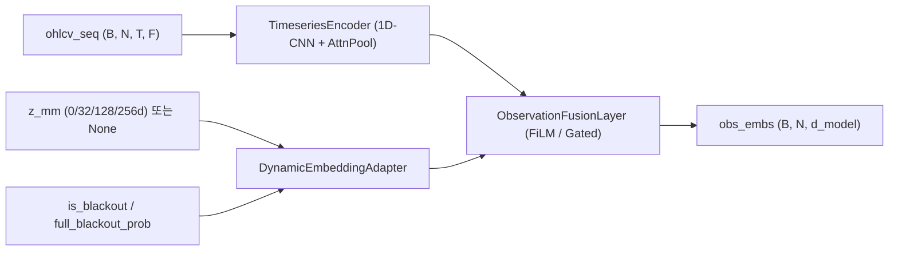

# Model B 관계형 백본, 어댑터 및 다기간 Action Chunking 아키텍처

`hyperalpha-vla`는 ZeroStreet의 오픈소스(MIT) 포트폴리오 의사결정 모델(`Model B`)로, **공유 가능한 Cross-Asset 관계형 백본(`HyperAlphaVLABackbone`)**과 **유저 에이전트 개별 컴파일 전용 Policy Head(`WeightAllocatorHead`)**를 엄격히 분리합니다.

---

## 1. 단일 패스 관측 융합 (`adapters.py`)

`ObservationFusionLayer`는 배치당 단 1회 실행되어 시계열 표현과 동적 멀티모달 임베딩(`z_mm`)을 융합합니다.

- **Ticker-Agnostic `TimeseriesEncoder`**: 기존 고정 종목 인덱스 매핑(`static_indicator_map`)을 제거하고 1D-CNN + `LayerNorm` + 어텐션 풀링으로 임의의 종목 유니버스를 수용합니다.
- **`DynamicEmbeddingAdapter`**: `supported_dims=(32, 128, 256)` 선형 투영 딕셔너리를 보유하며, `z_mm=None`, `dim=0`, 또는 `is_blackout=True`인 자산 위치에 학습 가능한 `[MASK_SIGNAL]` 파라미터를 주입하여 로컬 OHLCV 단독 모드에서도 추론이 중단되지 않습니다.

---

## 2. 다기간 행동 청킹 및 비대칭 어텐션 마스킹 (`model.py`, `moe.py`)

`HyperAlphaVLABackbone.forward_backbone`은 `obs_embs`로부터 향후 `H`영업일 포트폴리오 쿼리 블록 `[P_0, P_1, ..., P_{H-1}]`을 생성하고 `MoETransformerBackbone`(초기 `n_dense_layers`개 Dense + 후속 Shared/Routed `TopKMoELayer` 적층)을 통과시킵니다.

1. **`P_0` 영벡터 호라이즌 초기화**: `horizon_encodings.weight[0]`을 `0.0`으로 초기화하여 당일 실행 블록(`P_0`) 표현을 안정화합니다.
2. **`P_0` 전용 직전 비중 앵커링**: 실제 계좌 보유 비중 `prev_weights`는 `weight_encoder`를 거쳐 오직 `k=0` (`P_0`) 블록에만 더해지며, 미래 블록(`P_1..P_{H-1}`)은 트랜스포머 어텐션을 통해 시작 상태를 전달받아 오차 누적을 차단합니다.
3. **비대칭 2D 호라이즌 마스크 (`build_horizon_attention_mask`)**:
   - `obs_embs`는 미래 포트폴리오 블록(`P_1..P_{H-1}`)을 절대 참조하지 못하도록 차단(`True`)해 관측 오염을 막습니다.
   - 포트폴리오 블록 간에는 `bidirectional_portfolio`, `causal_portfolio`, `backward_dp` 3가지 모드를 지원합니다.

---

## 3. Policy Head 0바이트 분리 및 희소 심플렉스 투영 (`activations.py`)

| 모듈 / 메서드 | 규제 안전 및 수치 불변식 |
| :--- | :--- |
| **`HyperAlphaVLA.__init__`** | `user_config=None` 기본값을 유지하며, 미입력 시 즉시 `ValueError`를 발생시켜 사전학습된 회사 Policy 가중치가 **0바이트**임을 강제합니다. |
| **`HyperAlphaVLABackbone.save_backbone`** | 오직 백본 파라미터와 모델 하이퍼파라미터만 저장하며 `policy_head` 키를 포함하지 않습니다. |
| **`WeightAllocatorHead`** | FP32 로짓에 거래 불가 자산(`valid_mask == 0`)을 `-1e9`로 마스킹한 뒤 `entmax15`, `sparsemax`, 또는 `softmax`로 각 스텝 비중 합이 `1.0`인 희소 포트폴리오 궤적 `(B, H, N)`을 산출합니다. |

`Entmax15Function`과 `SparsemaxFunction`은 PyTorch custom `autograd.Function`으로 구현되어 전·역전파 모두 FP32에서 수치 안정적으로 동작합니다.
