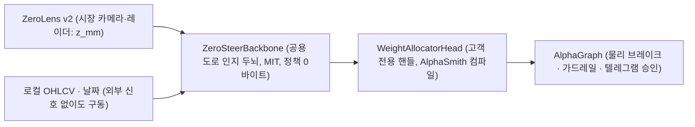
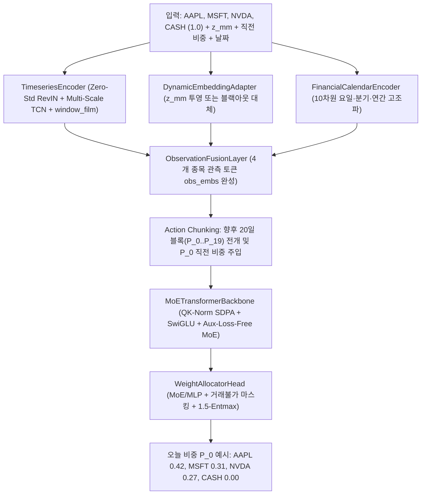
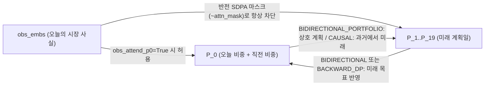
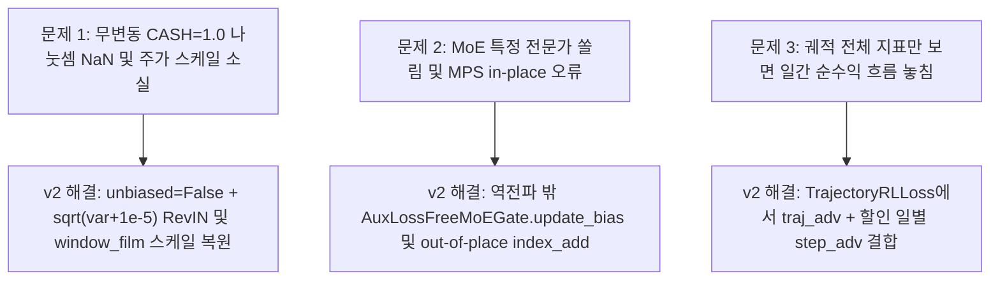
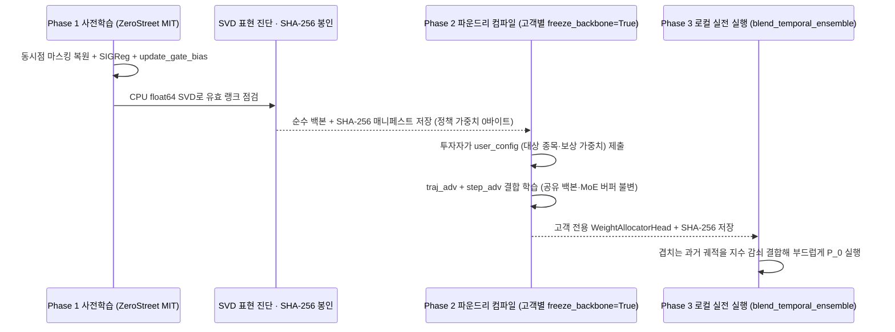

# ZeroSteer v2 직관적 이해 및 도식 가이드

**ZeroLens v2**가 시장 데이터를 읽는 **"카메라와 레이더"**라면, **ZeroSteer v2**(`zerosteer`)는 그 신호와 가격 흐름을 받아 **오늘부터 향후 20일간 자산 비중을 어떻게 움직일지 판단하는 "포트폴리오 자율주행 핸들"**입니다. 특히 공용 도로 인지 두뇌(`ZeroSteerBackbone`)와 고객 맞춤 핸들(`WeightAllocatorHead`)을 **회사 정책 가중치 0바이트 원칙**으로 분리해 자본시장법 안전성과 투자자 통제권을 함께 지킵니다.

---

## 1. 자율주행 비유로 보는 전체 구조

ZeroLens 센서, ZeroSteer 두뇌·핸들, 그리고 AlphaGraph 안전 브레이크가 어떻게 맞물리는지 한눈에 봅니다.

두 가지 철칙이 생태계를 보호합니다.
1. 외부 센서(`z_mm`)가 없거나 끊겨도(`is_blackout=True` 또는 `None`) `DynamicEmbeddingAdapter`가 기본 학습 토큰(`mask_signal_token`)을 채워 로컬 OHLCV 가격표만으로 안전하게 주행합니다.
2. 고객 본인의 투자 설정(`user_config`) 없이 [`ZeroSteer`](../../src/zerosteer/model.py#L401-L555)나 [`DifferentiableTrajectoryRLTrainer`](../../src/zerosteer/rl_trainer.py#L341-L510)를 생성하려고 하면 즉시 `ValueError`로 막아, 회사가 정해 준 매매 가중치가 배포될 여지를 없앴습니다.

---

## 2. 구체적 4종목 실전 데이터 여정 (`AAPL, MSFT, NVDA, CASH=1.0`)

기술주 3종목과 가격이 항상 `1.0`(변동성 `0.0`)인 현금 `CASH`가 들어갔을 때 최종 비중이 나오는 과정입니다.

**행동 청킹(`H=20`)**의 핵심 직관은 **"오늘 하루 비중(`P_0`)만 즉흥적으로 정하지 않고 향후 20일간의 리밸런싱 경로(`P_0..P_19`)를 함께 초안 작성한 뒤 오늘분(`P_0`)을 실행한다"**는 점입니다. 덕분에 내일 바로 되돌릴 불필요한 잦은 매매와 거래비용 손실을 크게 줄일 수 있습니다.

---

## 3. 미래 정보 오염 차단 마스크 (`HorizonMaskMode`)

오늘의 시장 사실(`obs_embs`)과 미래 계획 블록(`P_0..P_19`) 사이에 왜 특수한 어텐션 칸막이를 세울까요?

- **오염 차단 원칙**: `obs_embs`는 오늘 실제로 관측된 시장 사실이므로 미래의 가상 계획(`P_1..P_19`)을 엿보며 왜곡되면 안 됩니다.
- **v2 핵심 안전장치 (`~attn_mask` 반전)**: [`build_horizon_attention_mask`](../../src/zerosteer/model.py#L76-L119)에서는 `True`가 "차단"을 뜻하지만 PyTorch 고속 어텐션(`F.scaled_dot_product_attention`)은 반대로 `True`를 "허용"으로 해석합니다. [`QKNormMultiheadAttention`](../../src/zerosteer/moe.py#L107-L163)은 `sdpa_mask = ~attn_mask` 반전을 명시적으로 적용해 미래 토큰 누수를 정확히 `0.0`으로 막습니다.

---

## 4. ZeroSteer v2 내부 핵심 업그레이드 이유

실전 퀀트 운용에서 자주 터지는 세 가지 문제를 v2가 어떻게 해결했는지 요약한 구조도입니다.

| 도입 기술 | 없으면 벌어지는 문제 | ZeroSteer v2 해결 방식 | 구현 위치 |
| :--- | :--- | :--- | :--- |
| **Zero-Std RevIN + Multi-Scale TCN + `window_film`** | 변동이 `0`인 `CASH=1.0` 자산에서 `0/0=NaN` 오류가 나거나 주가 레벨(`1.0` vs `50.0`) 차이가 지워집니다. | `unbiased=False` + `sqrt(var + 1e-5)`로 현금 자산을 `0.0`에 안전 고정하고, `(3, 7, 15)` TCN과 `window_film`(`[mean, log1p(std)]`)으로 스케일을 되살립니다. | [`adapters.py`](../../src/zerosteer/adapters.py#L197-L306) |
| **`FinancialCalendarEncoder`** | 금요일 리밸런싱, 분기말·연말 수급 패턴을 시계열만으로 포착하기 어렵습니다. | 10차원 고정 고조파(요일·분기·연간 `sin`/`cos`) + `RMSNorm` + 학습형 `gate`로 결합하며 미입력 시 깔끔히 건너뜁니다. | [`adapters.py`](../../src/zerosteer/adapters.py#L37-L122) |
| **`QKNormMultiheadAttention` + `SwiGLUFeedForward`** | 종목·기간이 늘어날수록 어텐션 점수가 폭주해 학습이 불안정해집니다. | 헤드별 `RMSNorm` Q/K 정규화, `~attn_mask` SDPA 반전, 편향 없는 `SwiGLUFeedForward`를 적용했습니다. | [`moe.py`](../../src/zerosteer/moe.py#L62-L163) |
| **`AuxLossFreeMoEGate` + MoE `WeightAllocatorHead`** | 기존 보조 균형 손실은 수익 최적화를 방해하고 in-place `index_add_`는 MPS에서 깨집니다. | 역전파 바깥 `update_gate_bias()` 균형 조절, MPS 안전 `index_add`, MoE 기반 `WeightAllocatorHead`를 적용했습니다. | [`moe.py`](../../src/zerosteer/moe.py#L165-L359), [`model.py`](../../src/zerosteer/model.py#L307-L399) |
| **LeJEPA `compute_sigreg_loss` + `diagnostics.py`** | 사전학습 모델이 모든 종목에 똑같은 벡터만 뱉는 표현 붕괴(collapse)에 빠지기 쉽습니다. | 복소 FFT 없는 오일러 `cos`/`sin` `SIGReg` 손실과 CPU `float64` SVD 유효 랭크 진단(`ZeroSteerDiagnosticReport`)을 내장했습니다. | [`pretrain.py`](../../src/zerosteer/pretrain.py#L16-L178), [`diagnostics.py`](../../src/zerosteer/diagnostics.py#L16-L112) |
| **강화된 `TrajectoryRLLoss` + `freeze_backbone` 잠금** | `step_reward_weight`가 무시되거나 고객 헤드 학습 중 공유 백본 MoE 버퍼가 변할 수 있습니다. | 궤적(`traj_adv`)과 할인 일간 순수익(`step_adv`)을 결합하고 `include_backbone=not freeze_backbone`으로 백본·버퍼 비트 불변성을 지킵니다. | [`rl_trainer.py`](../../src/zerosteer/rl_trainer.py#L27-L510) |
| **SHA-256 `.manifest.json` + `legacy_v1()`** | 손상·변조된 가중치 파일 로드를 막기 어렵고 v1 대비 성능 비교가 번거롭습니다. | 동위 `.manifest.json` SHA-256 해시를 검증해 변조 파일을 거부하고, `ZeroSteerConfig.legacy_v1()`로 v1 어블레이션을 즉시 실행합니다. | [`model.py`](../../src/zerosteer/model.py#L24-L60), [`config.py`](../../src/zerosteer/config.py#L77-L97) |

---

## 5. 3단계 실전 운영 생애주기

공개 백본 학습(Phase 1) → 고객 맞춤 정책 컴파일(Phase 2) → 일간 시간축 앙상블 실전 실행(Phase 3) 순서입니다.

## 관련 문서

- [zerosteer v0.2.0 개요 및 빠른 시작](../quickstart.md)
- [ZeroSteer v2 백본 · 어댑터 및 정책 분리 아키텍처](../architecture/backbone-and-adapters.md)
- [사전학습 · SIGReg · 표현 진단 및 궤적 RL 워크플로우](../workflows/pretrain-and-trajectory-rl.md)
