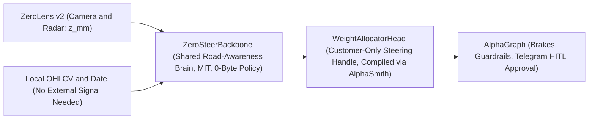
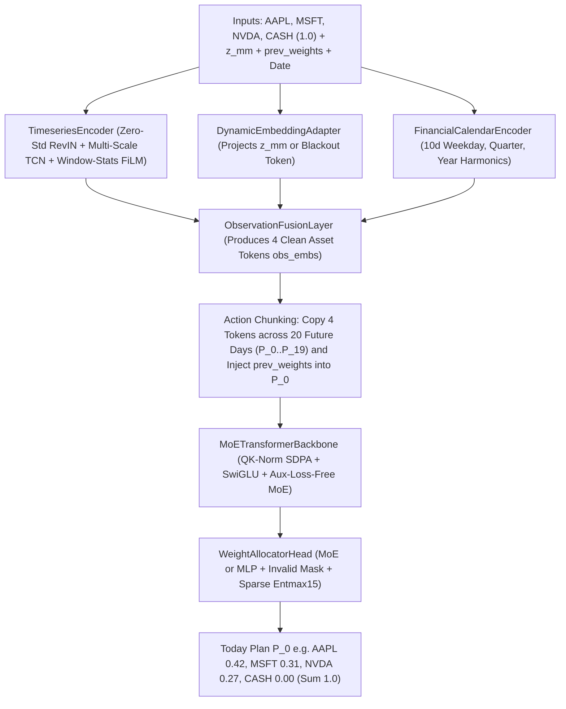
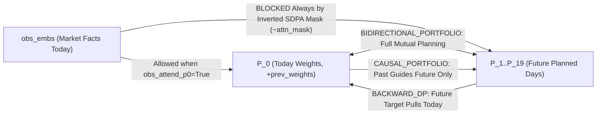
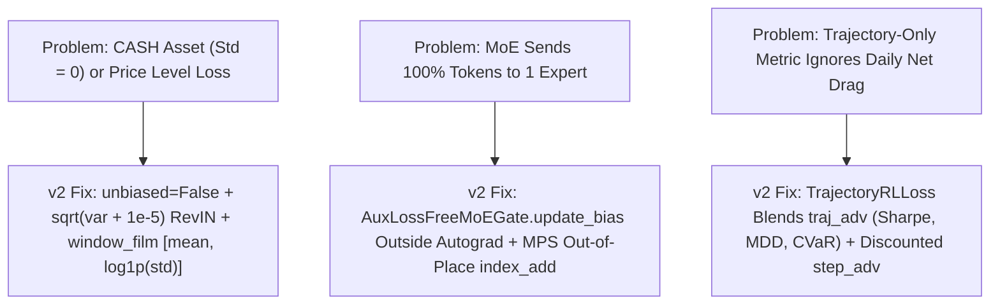
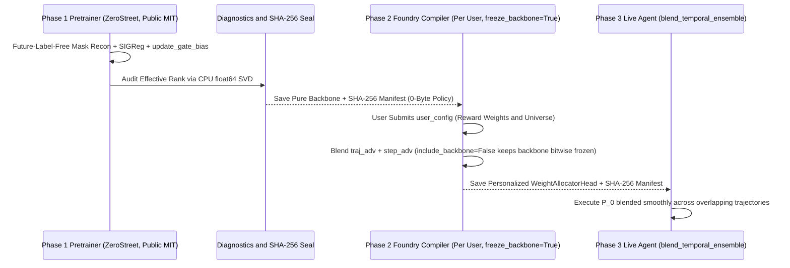

# ZeroSteer v2 Intuitive Visual Guide / ZeroSteer v2 직관적 이해 및 도식 가이드

If **ZeroLens v2** is the *"camera and radar reading the financial road"*, then **ZeroSteer v2** (`zerosteer`) is the **"Self-Driving Portfolio Steering System"**—split cleanly into an open-source road-awareness brain (`ZeroSteerBackbone`) and a private customer-compiled steering head (`WeightAllocatorHead`) that never contains vendor-chosen stock picks (`0 bytes`).

**ZeroLens v2**가 시장을 읽는 **"고성능 카메라·센서"**라면, **ZeroSteer v2**(`zerosteer`)는 그 신호와 가격 차트를 보고 **오늘부터 향후 20일간 자산 비중을 어떻게 분배할지 계획하는 "포트폴리오 자율주행 핸들"**입니다. 특히 공용 두뇌(`ZeroSteerBackbone`)와 고객 맞춤 핸들(`WeightAllocatorHead`)을 **0바이트 원칙**으로 분리해 자본시장법 규제 안전성과 투명성을 동시에 확보합니다.

---

## 1. Autonomous Driving Analogy & Ecosystem Map / 자율주행 비유로 보는 전체 구조

Look at how the open-source backbone and customer policy head fit between ZeroLens sensors and AlphaGraph safety brakes.

공유되는 백본 두뇌와 고객 전용 핸들이 ZeroLens 센서 및 AlphaGraph 안전 브레이크와 어떻게 연결되는지 한눈에 봅니다.

* **English**: Two critical rules protect both sides:
  1. Even if `ZeroLens` (`z_mm`) is disconnected (`is_blackout=True` or `None`), `DynamicEmbeddingAdapter` plugs in a learned placeholder so `ZeroSteerBackbone` drives safely on local OHLCV prices alone.
  2. Trying to build [`ZeroSteer`](../../src/zerosteer/model.py#L401-L555) or [`DifferentiableTrajectoryRLTrainer`](../../src/zerosteer/rl_trainer.py#L341-L510) with `user_config=None` fails loudly (`ValueError`), proving ZeroStreet ships zero default advisory strategies.
* **한국어**: 두 가지 철칙이 생태계를 보호합니다:
  1. 외부 센서(`z_mm`)가 없거나 끊겨도(`is_blackout=True`) `DynamicEmbeddingAdapter`가 기본 토큰(`mask_signal_token`)을 채워 로컬 OHLCV 가격표만으로 즉시 동작합니다.
  2. 고객 본인의 투자 성향 설정(`user_config`) 없이 `ZeroSteer`나 트레이너를 생성하려고 하면 즉시 `ValueError`로 막아, 회사가 정해 준 매매 가중치를 배포할 수 없게 설계했습니다.

---

## 2. Concrete 4-Asset Data Journey (`AAPL, MSFT, NVDA, CASH=1.0`) / 구체적 4종목 실전 데이터 흐름

Follow a concrete mini-portfolio of 3 tech stocks plus `CASH` (always price `1.0`, volatility `0.0`) from raw numbers to sparse portfolio weights:

구체적인 가상 포트폴리오(기술주 3종 + 항상 가격 `1.0`인 무변동 현금 `CASH`)가 들어가서 최종 비중이 나오기까지의 여정을 따라가 봅니다.

* **English**: Notice why **Action Chunking (`H=20`)** is powerful: instead of deciding only today's allocation blindly (`P_0`), `ZeroSteerBackbone` drafts a coherent **20-day roadmap (`P_0..P_19`)** factoring in turnover costs, current holdings (`prev_weights` injected at `P_0`), and cross-asset relationships—then executes day `P_0` cleanly while checking overlap across days.
* **한국어**: **행동 청킹(Action Chunking, `H=20`)**의 핵심 직관은 **"오늘 하루 비중(`P_0`)만 즉흥적으로 찍지 않고 향후 20일간의 리밸런싱 계획(`P_0..P_19`)을 한꺼번에 초안 작성한 뒤 오늘치(`P_0`)를 실행한다"**는 점입니다. 덕분에 내일 다시 뒤집을 불필요한 매매와 수수료 손실을 크게 줄일 수 있습니다.

---

## 3. Asymmetric Horizon Masking Partition / 미래 정보 오염 차단 마스크 도식

Why does ZeroSteer have special mask modes (`BIDIRECTIONAL_PORTFOLIO`, `CAUSAL_PORTFOLIO`, `BACKWARD_DP`), and what changed in v2's `QKNormMultiheadAttention`?

왜 시점(`obs_embs`) 토큰과 미래 계획(`P_0..P_19`) 토큰 사이에 특수한 칸막이(어텐션 마스크)를 세울까요?

* **English**:
  * **Leakage Prevention Rule**: `obs_embs` represents **market reality today**; it must NEVER absorb speculative drafts from future blocks `P_1..P_19`.
  * **ZeroSteer v2 SDPA Polarity Fix**: In [`build_horizon_attention_mask`](../../src/zerosteer/model.py#L76-L119), `True` means **blocked**. Because PyTorch `F.scaled_dot_product_attention` uses the opposite convention for bool masks (`True = attend`), [`QKNormMultiheadAttention`](../../src/zerosteer/moe.py#L107-L163) explicitly applies `sdpa_mask = ~attn_mask` so future horizon leakage stays literally `0.0`.
* **한국어**:
  * **오염 차단 원칙**: 오늘의 시장 사실(`obs_embs`)이 내일 이후의 가상 계획(`P_1..P_19`)을 엿보며 왜곡되는 것을 물리적으로 막기 위해 단방향 칸막이를 칩니다.
  * **v2 핵심 안전장치 (`~attn_mask` 반전)**: PyTorch 최신 고속 어텐션(SDPA)은 기존 `MultiheadAttention`과 불리언 마스크 참·거짓 의미가 정반대여서, 자칫하면 미래 토큰을 막는 대신 **허용해 버리는 치명적 실수**가 생길 수 있습니다. v2에서는 `~attn_mask` 반전 처리를 명시적으로 넣고 단위 테스트로 누수 `0.0`을 검증했습니다.

---

## 4. Inside ZeroSteer v2 Key Upgrades / ZeroSteer v2 핵심 내부 장치 도식

ZeroSteer v2 upgrades three internal bottlenecks—constant `CASH` stability, MoE routing fairness without auxiliary losses, and balanced step-plus-trajectory RL signals.

ZeroSteer v2에서는 실전 퀀트 환경에서 발생하기 쉬운 세 가지 병목(`CASH` NaN 위험, MoE 쏠림, RL 보상 쏠림)을 아래 구조로 해결했습니다.

### Why Each Technique Exists / 각 기술을 왜 넣었나? (없으면 발생하는 문제)

| Upgrade / 도입 기술 | Problem Without It / 없으면 벌어지는 문제 | How ZeroSteer v2 Solves It / ZeroSteer v2 해결 방식 | Code / 구현 위치 |
| :--- | :--- | :--- | :--- |
| **Zero-Std RevIN + Window-Stats FiLM + Multi-Scale TCN** | Constant `CASH = 1.0` causes `0/0 = NaN` in naive normalization, or normalizes away `1.0` vs `50.0` price/vol regimes. / 무변동 `CASH=1.0`에서 나눗셈 `NaN`이 터지거나, 고변동 주가와 현금의 스케일 차이가 지워집니다. | Uses `unbiased=False` + `sqrt(var + 1e-5)` so constant inputs map safely to `0.0`, extracts `(3, 7, 15)` TCN patterns with reversed recency pos, and restores `[mean, log1p(std)]` via `window_film`. / 무변동 자산은 안전하게 `0.0`을 유지하되 `window_film`으로 현금과 고변동 주식의 스케일 차이를 명확히 보존합니다. | [`adapters.py`](../../src/zerosteer/adapters.py#L197-L306) |
| **`FinancialCalendarEncoder`** | Policy ignores Friday rebalancing jumps, quarter-end window dressing, or turn-of-year flows. / 금요일 마감, 분기말·연말 수급 패턴을 시계열만으로는 놓치기 쉽습니다. | Injects deterministic 10d sin/cos weekday/quarter/year features via fixed harmonic projection + `RMSNorm` + `gate` (skipped automatically if `calendar_feats=None`). / 10차원 금융 캘린더 고조파를 학습 게이트로 융합하며 미입력 시 기존과 100% 동일하게 호환됩니다. | [`adapters.py`](../../src/zerosteer/adapters.py#L37-L122) |
| **`QKNormMultiheadAttention` + `SwiGLUFeedForward`** | Transformer attention logits explode across diverse assets/horizons and standard dense MLPs express less cleanly. / 종목 수가 늘어나면 어텐션 점수가 폭주해 학습이 불안정해집니다. | Normalizes Q and K per head with `RMSNorm`, handles SDPA mask inversion (`~attn_mask`), and uses bias-free SwiGLU gated FFNs. / 헤드별 Q·K `RMSNorm`과 SwiGLU로 깊은 층에서도 안정적 학습을 유지합니다. | [`moe.py`](../../src/zerosteer/moe.py#L62-L163) |
| **`AuxLossFreeMoEGate` + MoE `WeightAllocatorHead`** | Traditional balance loss degrades return optimization, and in-place `index_add_` breaks on Apple Silicon MPS. / 기존 MoE 균형 손실은 본 학습을 방해하고 Apple Silicon MPS에서 오류가 날 수 있습니다. | Balances expert counts outside autograd via `update_gate_bias()`, uses out-of-place `index_add`, and upgrades `WeightAllocatorHead` into a compact MoE allocator. / 역전파 밖 바이어스 보정 + MPS 안전 `index_add`로 백본과 할당기 헤드를 모두 안정화했습니다. | [`moe.py`](../../src/zerosteer/moe.py#L165-L359), [`model.py`](../../src/zerosteer/model.py#L307-L399) |
| **LeJEPA `compute_sigreg_loss` + `diagnostics.py`** | Pretrainer can cheat by outputting identical embeddings for every asset; MPS lacks `float64` SVD. / 사전학습 모델이 모든 종목에 같은 벡터를 내도 손실이 줄어드는 현상을 막고 MPS 진단 오류를 피해야 합니다. | Integrates Euler `cos`/`sin` SIGReg anti-collapse loss cleanly on CPU/CUDA/MPS and computes SVD effective rank on `.cpu().to(dtype=torch.float64)`. / 복소 FFT 없는 SIGReg와 CPU 이관 후 `float64` SVD 진단(`ZeroSteerDiagnosticReport`)을 내장했습니다. | [`pretrain.py`](../../src/zerosteer/pretrain.py#L16-L178), [`diagnostics.py`](../../src/zerosteer/diagnostics.py#L16-L112) |
| **Hardened `TrajectoryRLLoss` & `freeze_backbone` Lock** | `step_reward_weight` was unused in v1, and MoE buffer updates could accidentally mutate a frozen shared backbone. / v1에서는 스텝 보상 비율이 미반영되었고 백본 동결 시 MoE 버퍼 오염 우려가 있었습니다. | Blends trajectory metrics + discounted daily net return `step_adv`, calls `update_gate_bias(include_backbone=not self.freeze_backbone)`, and supports cosine warmup + frozen sync. / 스텝·궤적 보상을 실제 결합하고 고객 헤드 컴파일 중 공유 백본 가중치와 버퍼의 비트 불변성을 지킵니다. | [`rl_trainer.py`](../../src/zerosteer/rl_trainer.py#L27-L510) |
| **SHA-256 `.manifest.json` & `legacy_v1()`** | Corrupted or swapped checkpoints could silently load; A/B comparison against v1 required manual code edits. / 체크포인트 파일 손상·변조를 감지 못하거나 v1 대비 성능 개선 비교가 번거롭습니다. | Writes sibling `<stem>.manifest.json` hashes verified by `load_backbone`/`load_policy_head`, and offers `ZeroSteerConfig.legacy_v1()` one-liner preset. / 동위 `.manifest.json` SHA-256 검증으로 변조 시 즉시 거부하며 `legacy_v1()`로 언제든 v1·v2 어블레이션이 가능합니다. | [`model.py`](../../src/zerosteer/model.py#L24-L60), [`config.py`](../../src/zerosteer/config.py#L77-L97) |

---

## 5. Three-Phase Operational Lifecycle / 3단계 실전 운영 생애주기

See how ZeroStreet trains the public backbone once, lets customers compile individualized policies safely on frozen backbones, and smooths daily live execution.

ZeroStreet의 공개 백본 사전학습부터 고객별 맞춤 정책 컴파일, 실거래 시간축 앙상블까지 3단계 전체 생명주기입니다.

---

## 6. v1 vs v2 Upgrade Summary / v1 대비 v2 핵심 진화 요약

| Dimension / 비교 항목 | v1 Baseline (`ZeroSteerConfig.legacy_v1()`) / 초기 v1 | ZeroSteer v2 Default / 현재 ZeroSteer v2 기본값 |
| :--- | :--- | :--- |
| **Timeseries Input / 시계열 입력** | Basic 1D-CNN + LayerNorm / 단순 1D-CNN | Zero-Std Safe RevIN + `(3, 7, 15)` Depthwise TCN + Reversed Recency + `window_film` |
| **Calendar / 캘린더 반영** | Disabled / 미지원 | Optional deterministic 10d `FinancialCalendarEncoder` (`calendar_feats`) |
| **Attention & FFN / 어텐션·FFN** | Standard MHA + GeGLU | `QKNormMultiheadAttention` (SDPA `~attn_mask` safe) + `SwiGLUFeedForward` + `RMSNorm` |
| **MoE & Policy Head / MoE 및 헤드** | Softmax MoE backbone + MLP head | `AuxLossFreeMoEGate` backbone + MoE `WeightAllocatorHead` (`use_moe_allocator=True`) |
| **Pretrain & Diagnostics / 사전학습·진단** | Mask MSE + cosine only / 단순 복원 손실만 존재 | Mask MSE + cosine + MPS-safe LeJEPA `compute_sigreg_loss` + SVD `ZeroSteerDiagnosticReport` |
| **RL Compiler & Security / 컴파일·보안** | Trajectory metrics + `.pt` save / 궤적 지표 중심 | Step+Trajectory advantage blending, frozen MoE buffer lock, warmup LR, SHA-256 `.manifest.json` |

## Related Documentation / 관련 문서

* [ZeroSteer Overview & Quickstart / 개요 및 빠른 시작](../quickstart.md)
* [ZeroSteer v2 Backbone, Adapters & Policy Split / 백본, 어댑터 및 Policy Head 분리 아키텍처](../architecture/backbone-and-adapters.md)
* [Pretraining, SIGReg, Diagnostics & Trajectory RL / 사전학습, SIGReg, 표현 진단 및 궤적 RL 워크플로우](../workflows/pretrain-and-trajectory-rl.md)
