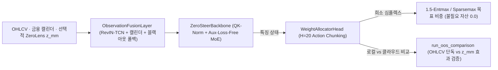

# zerosteer v0.2.0 개요 및 빠른 시작

## 왜 이 프로젝트가 필요한가요? (비즈니스 역할 및 소비자 가치)

`zerosteer`(`v0.2.0`, Public MIT)는 주식회사 제로스트리트(ZeroStreet Inc.)의 오픈소스 포트폴리오 제어 엔진입니다. 일반 투자자와 퀀트 개발자가 기존 자동매매 AI를 쓸 때 부딪히는 세 가지 답답함을 구조적으로 해결합니다.

1. **수백 개 종목을 애매하게 쪼개 담는 물타기 방지 (`1.5-Entmax`)**: 일반 Softmax 모델은 확신 없는 종목에도 조금씩 비중을 배정해 수수료만 늘립니다. `zerosteer`는 `Entmax15`와 `Sparsemax`를 써서 기준에 못 미치는 자산의 비중을 깔끔하게 **정확한 `0.0`**으로 비워 줍니다.
2. **내일 당장만 보는 단타 매매 대신 `20일` 경로 설계 (`Action Chunking H=20`)**: 한 번에 20거래일치 비중 경로를 함께 계획하고 직전 보유 비중(`prev_weights`)과 거래비용을 반영해 잦은 매매 손실을 줄입니다.
3. **회사가 찍어주는 종목 추천 없이 내 PC에서 안전하게 실행**: [`ZeroSteer`](../src/zerosteer/model.py)와 [`DifferentiableTrajectoryRLTrainer`](../src/zerosteer/rl_trainer.py)는 회사가 미리 학습한 매매 가중치를 **0바이트**로 유지하며, 투자자 설정(`user_config=None`)이 없으면 즉시 `ValueError`를 발생시킵니다. 고객이 직접 컴파일한 정책 헤드는 동위 `.manifest.json`의 SHA-256 검증으로 보호받습니다.

> **그림으로 직관적으로 먼저 보고 싶다면**: 자율주행 비유, 4종목(`AAPL·MSFT·NVDA·CASH`) 데이터 흐름, 5가지 핵심 도해가 담긴 [ZeroSteer v2 직관적 이해 및 도식 가이드](./guides/intuitive-visual-guide.md)부터 읽어보세요.

---

## v0.2.0 핵심 파이프라인 한눈에 보기



---

## 세부 문서 라우팅 맵

| 주제 | 문서 경로 | 핵심 내용 |
| :--- | :--- | :--- |
| **직관적 이해 및 도식** | [ZeroSteer v2 직관적 이해 및 도식 가이드](./guides/intuitive-visual-guide.md) | 자율주행 비유, 4종목 여정, 미래 오염 차단 마스크, v2 도입 이유, 3단계 생명주기 도해 |
| **백본 · 어댑터 · 분리** | [ZeroSteer v2 백본 · 어댑터 및 정책 분리 아키텍처](./architecture/backbone-and-adapters.md) | RevIN+ModernTCN, 10차원 `FinancialCalendarEncoder`, `QKNormMultiheadAttention`, `AuxLossFreeMoEGate`, MoE 헤드, SHA-256 |
| **사전학습 · 진단 · RL** | [사전학습 · SIGReg · 표현 진단 및 궤적 RL 워크플로우](./workflows/pretrain-and-trajectory-rl.md) | `compute_sigreg_loss`, `CrossAssetMaskedRelationalPretrainer`, CPU `float64` SVD 진단, Step+Trajectory `TrajectoryRLLoss`, OOS 비교 |

---

## v0.2.0 공개 API 및 YAML 예시 경계

- **최상위 공개 API ([`__init__.py`](../src/zerosteer/__init__.py))**: `__version__="0.2.0"`과 함께 `ZeroSteerConfig`(`legacy_v1()`), `QKNormMultiheadAttention`, `SwiGLUFeedForward`, `AuxLossFreeMoEGate`, `FinancialCalendarEncoder`, `extract_calendar_features`, `compute_sigreg_loss`, `compute_effective_rank`, `ZeroSteerDiagnosticReport`, `evaluate_backbone_representations` 등 핵심 v2 심볼을 공개합니다.
- **문법 참고용 설정 예시 ([`config.example.yaml`](../config.example.yaml))**: 가상 티커(`ASSET_A`, `ASSET_B`, `ASSET_C`, `CASH`)로 YAML 작성 규칙만 보여 주며 자동으로 불려오지 않습니다. 실사용 시 반드시 [`load_user_policy_config`](../src/zerosteer/config.py)로 검증해야 합니다.

---

## 설치 및 검증 (CPU · Apple Silicon MPS)

[`pyproject.toml`](../pyproject.toml)은 추가 외부 패키지 없이 편집 가능한 `../zerostreet-schema`와 `torch>=2.2.0`, `numpy>=1.26.0`, `pydantic>=2.7.0`, `pyyaml>=6.0.1`, `loguru>=0.7.2`를 사용합니다. [`tests/test_zerosteer_v2_architecture.py`](../tests/test_zerosteer_v2_architecture.py)는 CPU와 Apple Silicon MPS 정합성까지 검증합니다.

```bash
uv sync --dev
uv run ruff check .
uv run pytest -v
```
