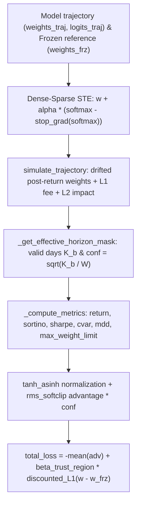

# Relational Pretraining, Trajectory RL & OOS Benchmark / 관계형 사전학습, 궤적 강화학습 및 OOS 벤치마크

`zerosteer` organizes training and evaluation into three decoupled stages: (1) open **Future-Label-Free relational pretraining**, (2) **per-user Trajectory RL Policy Head compilation**, and (3) **temporal ensembling & out-of-sample (OOS) validation**.

`zerosteer`는 ① 공개용 Future-Label-Free 관계형 백본 사전학습, ② 사용자 개별 목적함수 기반 Policy Head 컴파일(`Trajectory RL`), ③ 시간축 앙상블 및 OOS 성능 검증의 3단계 워크플로우를 제공합니다.

---

## 1. Future-Label-Free Relational Pretraining (`pretrain.py`) / 관계형 사전학습

`CrossAssetMaskedRelationalPretrainer` ([`pretrain.py`](../../src/zerosteer/pretrain.py)) learns **only cross-asset structural relationships at the same timestamp $t$**, keeping future returns and volatility strictly excluded:

`CrossAssetMaskedRelationalPretrainer`는 자본시장법 리스크를 차단하기 위해 오직 **동일 시점 $t$ 내 자산 관계 구조**만 학습합니다.

* Replaces a random fraction (`mask_ratio`, guaranteeing at least 1 masked asset) of observation tokens `obs_embs` with learnable `rel_mask_token`. (무작위 비율의 관측 토큰을 학습된 `rel_mask_token`으로 치환합니다.)
* Reconstructs masked tokens via `backbone.transformer` + `recon_head` using MSE + cosine alignment loss (`cosine_alignment`) against detached targets. (차폐된 토큰을 MSE + 코사인 정렬 손실로 복원합니다.)
* Calling `save_backbone` persists pure relational weights with **0 bytes** of Policy Head parameters. (`save_backbone` 호출 시 Policy Head 가중치가 없는 순수 백본만 저장됩니다.)

---

## 2. Differentiable Trajectory RL Loss & Compiler (`rl_trainer.py`) / 궤적 강화학습 손실 및 컴파일러

[`rl_trainer.py`](../../src/zerosteer/rl_trainer.py) computes differentiable trajectory policy updates:

### Numerical Stabilization & Portfolio Accounting / 주요 수치 안정화 및 계좌 회계 장치

1. **Post-Return Drifted Weights (`use_drifted_weights=True`) / 드리프트 사후 비중**: Uses end-of-day drifted weights `w_prev * (1 + r) / sum` as the pre-trade baseline for realistic turnover accounting. (전일 수익률에 의해 자연 변동된 비중을 다음 날 리밸런싱 기준 비중으로 반영합니다.)
2. **Dense-Sparse Straight-Through Estimator (`ste_softmax_alpha`) / 밀집-희소 기울기 투과**: Uses sparse `1.5-Entmax` weights in the forward pass while routing Softmax gradients in backward to prevent dead-weight stagnation. (순전파는 희소 비중, 역전파는 Softmax 기울기를 투과해 학습 정체를 막습니다.)
3. **`rms_softclip` & `tanh_asinh` / 변동성 정규화·소프트 클리핑**: Guards `batch_size=1` (`delta.shape[0] <= 1`) against `std()` NaN while smoothly bounding advantage spikes. (배치 크기 1에서의 NaN을 방지하고 기울기 폭주를 억제합니다.)
4. **Fast Backbone-Frozen Compile (`freeze_backbone=True`) / 고속 백본 동결 컴파일**: `DifferentiableTrajectoryRLTrainer` rejects `user_config=None` with `ValueError`, updates only `policy_head`, and returns the checkpoint's SHA-256 digest. (`user_config=None`을 거부하며 `policy_head`만 컴파일한 뒤 SHA-256 해시를 반환합니다.)

---

## 3. Temporal Ensembling & OOS Benchmarking (`model.py`, `benchmark.py`) / 시간축 앙상블 및 OOS 벤치마크

* **Receding-Horizon Temporal Ensemble (`ZeroSteer.blend_temporal_ensemble`) / 시간축 앙상블**: Blends overlapping historical action trajectories `traj[:, lag_m, :]` with exponential decay $\beta^m$ and simplex normalization ([`model.py`](../../src/zerosteer/model.py)). (과거 중첩 궤적을 지수 감쇠 가중치로 결합해 휩소를 억제합니다.)
* **OOS Comparison (`run_oos_comparison`) / OOS 비교 벤치마크**: Evaluates identical policy weights under `is_blackout=True` (OHLCV only) versus `z_mm` multimodal injection, computing `OOSBenchmarkReport` across return, annualized Sharpe/Sortino, MDD, and 15% tail CVaR ([`benchmark.py`](../../src/zerosteer/benchmark.py)). (OHLCV 단독 모드와 `z_mm` 주입 모드의 샤프·소르티노·MDD·CVaR 격차를 산출합니다.)

## Related Documentation / 관련 문서

* [ZeroSteer Relational Backbone, Adapters & Action Chunking / ZeroSteer 관계형 백본 및 어댑터](../architecture/backbone-and-adapters.md)
* [zerosteer Quickstart & Business Overview / 빠른 시작 및 비즈니스 개요](../quickstart.md)
