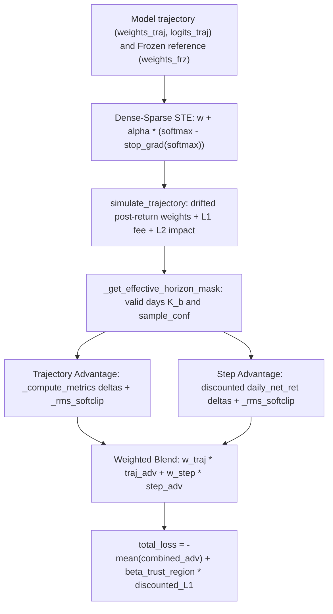

# Pretraining, SIGReg, Diagnostics & Trajectory RL / 사전학습, SIGReg, 표현 진단 및 궤적 RL 워크플로우

`zerosteer` structures model development and customer specialization into four decoupled stages: (1) open **Future-Label-Free relational pretraining with LeJEPA SIGReg**, (2) **representation collapse & MoE balance diagnostics**, (3) **per-user Trajectory RL Policy Head compilation**, and (4) **temporal ensembling & out-of-sample (OOS) / MPS parity validation**.

`zerosteer`는 ① LeJEPA SIGReg 기반 Future-Label-Free 관계형 사전학습, ② SVD 유효 랭크·등방성·MoE 부하 표현 진단, ③ 사용자별 Step+Trajectory 어드밴티지 기반 궤적 RL 컴파일, ④ 시간축 앙상블 및 OOS/Apple Silicon MPS 정합성 검증의 4단계 워크플로우로 구성됩니다.

---

## 1. Future-Label-Free Pretraining & LeJEPA SIGReg (`pretrain.py`) / 관계형 사전학습 및 SIGReg 정규화

`CrossAssetMaskedRelationalPretrainer` ([`pretrain.py`](../../src/zerosteer/pretrain.py)) learns **only cross-asset structural relationships at the same timestamp $t$**, keeping future returns, rankings, and volatility strictly excluded:

`CrossAssetMaskedRelationalPretrainer`는 자본시장법 규제 리스크를 차단하기 위해 오직 **동일 시점 $t$ 내 자산 간 관계 구조**만 학습합니다.

* **Intra-Timestamp Masking & Calendar Conditioning / 동시점 마스킹 및 캘린더 조건화**: Masks at least one asset per sample with `rel_mask_token`, accepts optional `calendar_feats`, and reconstructs detached `obs_embs` targets via `mse_loss + 0.1 * (1.0 - cosine_alignment)`. (배치당 최소 1개 자산 이상을 `rel_mask_token`으로 차폐하고 MSE + 코사인 정렬 손실로 복원합니다.)
* **MPS-Safe LeJEPA `compute_sigreg_loss` / 복소 FFT 없는 등방성 정규화**: Projects `(N, D)` encoded representations onto random unit slices and integrates weighted squared error against the standard Gaussian characteristic function $\phi(t) = e^{-t^2/2}$ using trapezoidal integration and real Euler `cos`/`sin` (`torch.fft` free) so execution matches across CPU, CUDA, and Apple Silicon MPS. (임베딩을 무작위 단위 방향에 투영한 뒤 실수 오일러 `cos`/`sin` 사다리꼴 적분으로 표준 정규 특성 함수와 대조하여 표상 붕괴를 방지하며 MPS에서도 동일하게 실행됩니다.)
* **Per-Step Aux-Loss-Free Bias Update / 스텝별 게이트 바이어스 보정**: Calls `self.backbone.update_gate_bias()` right after `optimizer.step()` and persists pure backbone checkpoints plus `.manifest.json` (`0 bytes` of Policy Head weights). (최적화 스텝 직후 `update_gate_bias()`를 호출하고 정책 헤드 0바이트 순수 백본만 저장합니다.)

---

## 2. Representation Collapse & MoE Diagnostics (`diagnostics.py`) / 표현 붕괴 및 MoE 진단

[`diagnostics.py`](../../src/zerosteer/diagnostics.py) evaluates pre-trained or fine-tuned backbones without mutating weights:

[`diagnostics.py`](../../src/zerosteer/diagnostics.py)는 백본의 표상 붕괴 여부와 전문가 라우팅 균형을 비학습 모드로 정량 진단합니다.

* **`compute_effective_rank` (CPU `float64` Safe SVD)**: Transfers flattened embeddings via `.detach().cpu().to(dtype=torch.float64)` **before** dtype casting (avoiding Apple Silicon MPS `Undefined type Double` errors) to compute Shannon singular-value entropy $\exp(H(s))$ (`effective_rank`) and `normalized_rank`. (Apple Silicon MPS의 Double 미지원 제약을 회피하기 위해 먼저 CPU로 이동한 뒤 `float64` SVD로 유효 랭크와 정규화 랭크 비율을 계산합니다.)
* **`evaluate_backbone_representations`**: Runs `backbone.forward_backbone(...)` in `eval()` mode, returning [`ZeroSteerDiagnosticReport`](../../src/zerosteer/diagnostics.py) containing `effective_rank`, `normalized_rank`, off-diagonal `mean_cosine_similarity`, seeded `sigreg_loss`, `embedding_std`, `num_tokens`, and `moe_load_stats`. (`ZeroSteerDiagnosticReport`를 통해 랭크 붕괴, 코사인 붕괴, SIGReg 점수 및 레이어별 MoE 부하 통계를 한 번에 점검할 수 있습니다.)

---

## 3. Hardened Trajectory RL Loss & Compiler (`rl_trainer.py`) / 강화된 궤적 RL 손실 및 컴파일러

[`rl_trainer.py`](../../src/zerosteer/rl_trainer.py) computes differentiable multi-horizon policy updates blending trajectory-level metrics and discounted daily net return advantages:

### Stability, Invariance & Compiler Features / 안정화, 불변식 및 컴파일러 기능

1. **Step + Trajectory Advantage Blending (`TrajectoryRLLoss`) / 스텝·궤적 어드밴티지 결합**: Computes `traj_adv` over all active risk/return metrics and discounted `step_adv` over `daily_net_ret`, sharing `_normalize_metric` (safe for `batch_size = 1`) and `_rms_softclip`, and returns `trajectory_advantage` and `step_advantage` telemetry alongside `total_loss`. (포트폴리오 지표 기반 `traj_adv`와 할인된 일별 순수익 `step_adv`를 설정 비율대로 결합하며 보조 지표까지 반환합니다.)
2. **Post-Return Drifted Weights & Dense-Sparse STE / 사후 드리프트 비중 및 Dense-Sparse STE**: Accounts for organic end-of-day weight drift (`use_drifted_weights=True`) while propagating Softmax gradients behind sparse `1.5-Entmax` weights. (일간 수익률 드리프트를 거래비용 기준에 반영하고 희소 비중의 역전파 정체를 해소합니다.)
3. **Frozen-Backbone Bitwise Invariance (`DifferentiableTrajectoryRLTrainer`) / 백본 동결 비트 불변식**: Rejects `user_config=None` with `ValueError`, clips `_trainable_params`, and calls `self.model.update_gate_bias(include_backbone=not self.freeze_backbone)` so compiled customer heads never mutate shared backbone weights or MoE gate buffers (`bias`, `expert_loads`, `last_load_counts`). (고객용 헤드 컴파일 시 `include_backbone=False`를 적용해 공유 백본의 가중치와 MoE 라우터 버퍼가 단 1비트도 변하지 않음을 보장합니다.)
4. **Warmup Cosine LR, Frozen Sync & Manifests / 워밍업 코사인 스케줄, 기준 정책 동기화 및 매니페스트**: Supports `lr_warmup_steps` cosine decay and periodic `model_frz_update_freq` synchronization of `self.frozen_model`, writing both `checkpoint_sha256` and sibling `<stem>.manifest.json`. (`lr_warmup_steps` 코사인 스케줄과 주기적 `frozen_model` 갱신을 지원하며 동위 `.manifest.json`을 함께 기록합니다.)

---

## 4. Temporal Ensembling, OOS Benchmarking & MPS Parity (`model.py`, `benchmark.py`) / 시간축 앙상블, OOS 및 MPS 검증

* **Receding-Horizon Temporal Ensemble (`ZeroSteer.blend_temporal_ensemble`) / 시간축 앙상블**: Blends overlapping historical trajectories `traj[:, lag_m, :]` using exponential decay $\beta^m$ and simplex normalization ([`model.py`](../../src/zerosteer/model.py)). (중첩 과거 궤적 결합으로 일간 리밸런싱 휩소를 억제합니다.)
* **OOS Comparison (`run_oos_comparison`) / OOS 비교 벤치마크**: Evaluates identical compiled policies under `is_blackout=True` (OHLCV only) versus `z_mm` injection across return, annualized Sharpe/Sortino, MDD, and 15% CVaR ([`benchmark.py`](../../src/zerosteer/benchmark.py)). (`is_blackout=True` 대비 `z_mm` 주입 시 OOS 성과 격차를 정량 리포트로 산출합니다.)
* **Apple Silicon MPS Verification (`tests/test_zerosteer_v2_architecture.py`) / Apple Silicon MPS 검증**: Verifies CPU vs MPS forward parity (`atol=1e-4`), MPS backward + `update_gate_bias` + `compute_sigreg_loss` + CPU-float64 `evaluate_backbone_representations`, and SHA-256 tamper rejection ([`tests/test_zerosteer_v2_architecture.py`](../../tests/test_zerosteer_v2_architecture.py)). (CPU-MPS 정합성(`atol=1e-4`), 역전파·SIGReg·SVD 진단 및 변조 차단이 테스트로 입증되어 있습니다.)

## Related Documentation / 관련 문서

* [zerosteer Overview & Quickstart / 개요 및 빠른 시작](../quickstart.md)
* [ZeroSteer v2 Backbone, Adapters & Policy Split / 백본, 어댑터 및 Policy Head 분리 아키텍처](../architecture/backbone-and-adapters.md)
