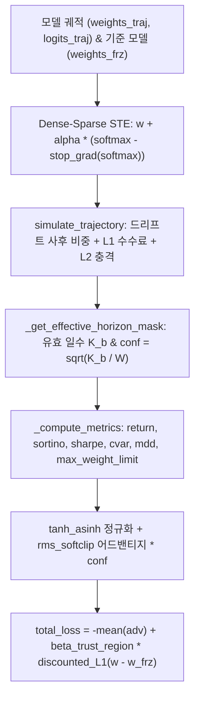

# 관계형 사전학습, 궤적 강화학습 컴파일 및 OOS 벤치마크

`hyperalpha-vla`는 **① 공개용 Future-Label-Free 관계형 백본 사전학습**, **② 사용자 개별 목적함수 기반 Policy Head 컴파일(`Trajectory RL`)**, **③ 시간축 앙상블 및 OOS 성능 검증** 3단계 워크플로우를 제공합니다.

---

## 1. Future-Label-Free 관계형 사전학습 (`pretrain.py`)

`CrossAssetMaskedRelationalPretrainer`는 자본시장법상 미래 수익률·변동성·리스크 예측 오해를 차단하기 위해, **오직 동일 시점 $t$ 내 자산 관계 구조**만 학습합니다.

- 입력 배치에서 무작위 비율(`mask_ratio`, 최소 1개 자산 보장)의 관측 토큰(`obs_embs`)을 학습 가능한 `rel_mask_token`으로 치환합니다.
- `backbone.transformer`와 `recon_head`를 통과시켜 마스킹된 자산의 `obs_embs.detach()`를 MSE + 코사인 정렬(`cosine_alignment`) 손실로 복원합니다.
- 학습 완료 후 `save_backbone`을 호출하면 Policy Head 가중치가 0바이트인 순수 백본만 저장됩니다.

---

## 2. 미분 가능 궤적 RL 손실 및 컴파일러 (`rl_trainer.py`)

### 주요 수치 안정화 및 계좌 회계 장치
1. **드리프트 사후 비중 (`use_drifted_weights=True`)**: $k-1$일차 보유 비중이 일별 수익률에 의해 자연 변동(`w_prev * (1 + r) / sum`)된 상태를 차기 리밸런싱 기준 비중으로 사용해 실제 계좌 회전율을 반영합니다.
2. **Dense-Sparse Straight-Through Estimator (`ste_softmax_alpha`)**: 순전파에는 `1.5-Entmax`의 희소 비중을 그대로 쓰되, 역전파에는 `Softmax` 그래디언트를 투과해 `0.0`으로 절단된 종목의 학습 정체를 막습니다.
3. **`rms_softclip` & `tanh_asinh`**: 배치 크기 1(`delta.shape[0] <= 1`)에서도 분산 `0/0` NaN이 발생하지 않도록 `_normalize_metric`에서 스케일을 분리·보정하고, 영점 보존 소프트 클리핑으로 기울기 폭주를 방지합니다.
4. **고속 백본 동결 컴파일 (`freeze_backbone=True`)**: `DifferentiableTrajectoryRLTrainer`는 `user_config=None` 입력 시 즉시 `ValueError`를 발생시키며, 기본 설정으로 백본 파라미터를 동결한 채 `policy_head`만 빠르게 업데이트한 뒤 체크포인트 SHA-256 해시를 반환합니다.

---

## 3. 시간축 앙상블 및 OOS 벤치마크 (`model.py`, `benchmark.py`)

- **Receding-Horizon Temporal Ensembling (`HyperAlphaVLA.blend_temporal_ensemble`)**: 과거 $m$일 전 추론 궤적의 $m$스텝 비중(`traj[:, m, :]`)을 지수 감쇠 가중치 $\beta^m$로 결합하고 심플렉스로 정규화해 휩소를 억제합니다.
- **OOS 비교 벤치마크 (`run_oos_comparison`)**: 동일 모델에 대해 `is_blackout=True`(OHLCV 단독)와 `z_mm` 주입 모드를 나란히 평가해 총수익률, 연율화 샤프/소르티노, MDD, 하위 15% CVaR 격차(`OOSBenchmarkReport`)를 산출합니다.
