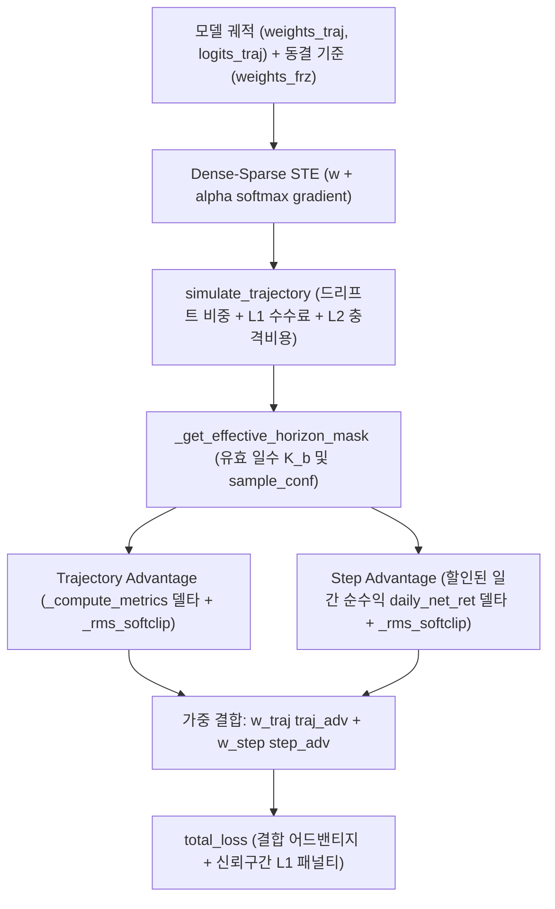

# 사전학습 · SIGReg · 표현 진단 및 궤적 RL 워크플로우

`zerosteer`는 모델 개발과 고객별 맞춤 학습을 네 단계로 깔끔하게 나눕니다.
1. **Future-Label-Free 관계형 사전학습 및 LeJEPA SIGReg 정규화**
2. **SVD 유효 랭크·코사인 붕괴·MoE 부하 표현 진단**
3. **고객별 궤적 강화학습(Step+Trajectory RL) 정책 헤드 컴파일**
4. **시간축 앙상블과 아웃오브샘플(OOS) · Apple Silicon MPS 정합성 검증**

---

## 1. Future-Label-Free 관계형 사전학습과 LeJEPA SIGReg (`pretrain.py`)

[`CrossAssetMaskedRelationalPretrainer`](../../src/zerosteer/pretrain.py#L16-L178)는 자본시장법 규제 리스크와 과적합을 막기 위해 **미래 수익률, 미래 순위, 미래 변동성 정답지를 전혀 보지 않고** 오직 **같은 시점(`t`) 안의 종목 간 관계 구조**만 학습합니다.

- **동시점 마스킹 및 캘린더 조건화**: 배치 샘플마다 최소 1개 자산을 `rel_mask_token`으로 가리고(선택적 `calendar_feats` 포함), 분리된 `obs_embs` 타깃을 `mse_loss + 0.1 * (1.0 - cosine_alignment)` 손실로 복원합니다.
- **복소 FFT 없는 MPS 안전 LeJEPA `compute_sigreg_loss`**: 모델이 모든 종목에 똑같은 임베딩을 뱉어 손실만 줄이는 표현 붕괴(collapse)를 막기 위해, `(N, D)` 임베딩을 무작위 단위 슬라이스에 투영한 뒤 실수 오일러 `cos`/`sin` 사다리꼴 적분으로 표준 가우스 특성 함수와 대조합니다. `torch.fft`를 쓰지 않으므로 CPU·CUDA·Apple Silicon MPS에서 동일하게 실행됩니다.
- **스텝별 Aux-Loss-Free 바이어스 보정**: `optimizer.step()` 직후 `self.backbone.update_gate_bias()`를 호출하고, 정책 헤드 가중치가 0바이트인 순수 백본 체크포인트와 `.manifest.json`만 저장합니다.

---

## 2. 표현 붕괴 및 MoE 부하 진단 (`diagnostics.py`)

[`diagnostics.py`](../../src/zerosteer/diagnostics.py#L16-L112)는 가중치를 변경하지 않고 백본의 표상 품질과 전문가 라우팅 균형을 정량적으로 점검합니다.

- **Apple Silicon MPS 호환 SVD (`compute_effective_rank`)**: Apple Silicon MPS가 64비트 배정밀도(`float64`) SVD를 지원하지 않는 제약을 우회하기 위해, 먼저 `.detach().cpu().to(dtype=torch.float64)` 순서로 CPU로 옮긴 뒤 샤논 특이값 엔트로피 기반 유효 랭크(`effective_rank`)와 `normalized_rank`를 계산합니다 ([tests/test_zerosteer_v2_architecture.py](../../tests/test_zerosteer_v2_architecture.py#L416-L482)).
- **종합 진단 리포트 (`evaluate_backbone_representations`)**: `eval()` 모드에서 `backbone.forward_backbone(...)`을 돌려 `effective_rank`, `normalized_rank`, 비대각 `mean_cosine_similarity`, 시드 고정 `sigreg_loss`, `embedding_std`, `num_tokens`, 레이어별 `moe_load_stats`가 담긴 `ZeroSteerDiagnosticReport`를 반환합니다.

---

## 3. 강화된 궤적 RL 손실 및 컴파일러 (`rl_trainer.py`)

[`rl_trainer.py`](../../src/zerosteer/rl_trainer.py#L27-L510)는 궤적 단위 지표와 할인된 일별 순수익 어드밴티지를 결합해 미분 가능한 다기간 정책 헤드를 학습합니다.

1. **스텝·궤적 어드밴티지 결합 (`TrajectoryRLLoss`)**: 포트폴리오 전체 궤적 지표(`traj_adv`)와 일별 할인 순수익 어드밴티지(`step_adv`)에 공통 `_normalize_metric`(`batch_size = 1` 안전)과 `_rms_softclip`을 적용한 뒤 `trajectory_reward_weight`와 `step_reward_weight` 비율로 결합하고, `trust_region` L1 패널티 및 보조 지표를 함께 반환합니다.
2. **사후 드리프트 비중 및 Dense-Sparse STE**: 일간 가격 변화로 자연스럽게 변한 보유 비중(`use_drifted_weights=True`) 기준으로 거래비용을 계산해 현실성을 높이고, `1.5-Entmax` 희소 비중 뒤에서도 Softmax 기울기가 막히지 않게 전파합니다.
3. **공유 백본 동결 비트 불변식 (`DifferentiableTrajectoryRLTrainer`)**: `user_config=None`이면 `ValueError`를 내며, `_trainable_params`만 기울기 클리핑하고 `self.model.update_gate_bias(include_backbone=not self.freeze_backbone)`를 호출해 고객 헤드 컴파일 중 공유 백본 가중치와 MoE 게이트 버퍼(`bias`, `expert_loads`, `last_load_counts`)가 단 1비트도 바뀌지 않게 잠급니다.
4. **워밍업 코사인 LR, 기준 정책 동기화 및 매니페스트**: `lr_warmup_steps` 코사인 스케줄과 주기적 `model_frz_update_freq` 동기화를 지원하며, `checkpoint_sha256`과 동위 `<stem>.manifest.json` 파일을 함께 생성합니다.

---

## 4. 시간축 앙상블 · OOS 비교 벤치마크 및 MPS 검증

- **후퇴 호라이즌 시간축 앙상블 (`ZeroSteer.blend_temporal_ensemble`)**: 과거에 작성해 둔 궤적 `traj[:, lag_m, :]` 중 오늘 날짜에 해당하는 비중들을 지수 감쇠 가중치로 결합해 일간 리밸런싱 흔들림(휩소)을 줄입니다 ([model.py](../../src/zerosteer/model.py)).
- **OOS 비교 리포트 (`run_oos_comparison`)**: 동일한 고객 정책을 `is_blackout=True`(OHLCV 가격만 사용) 조건과 `z_mm` 임베딩 주입 조건에서 아웃오브샘플(OOS)로 비교해 수익률, 연율화 샤프/소르티노, MDD, 15% CVaR 개선 폭을 수치로 검증합니다 ([benchmark.py](../../src/zerosteer/benchmark.py#L78-L121)).
- **Apple Silicon MPS 검증**: CPU-MPS 정합성(`atol=1e-4`), 역전파·SIGReg·SVD 유효 랭크·변조 파일 거부 테스트가 [tests/test_zerosteer_v2_architecture.py](../../tests/test_zerosteer_v2_architecture.py)에 구현되어 있습니다.

## 관련 문서

- [zerosteer v0.2.0 개요 및 빠른 시작](../quickstart.md)
- [ZeroSteer v2 직관적 이해 및 도식 가이드](../guides/intuitive-visual-guide.md)
- [ZeroSteer v2 백본 · 어댑터 및 정책 분리 아키텍처](../architecture/backbone-and-adapters.md)
